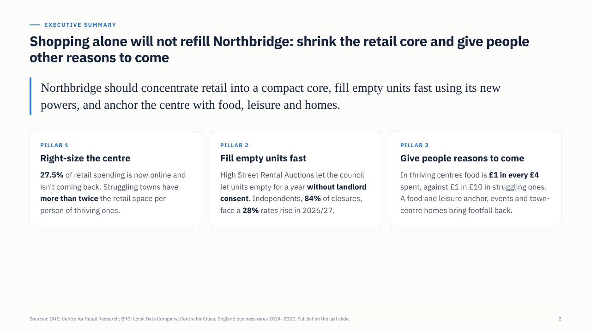
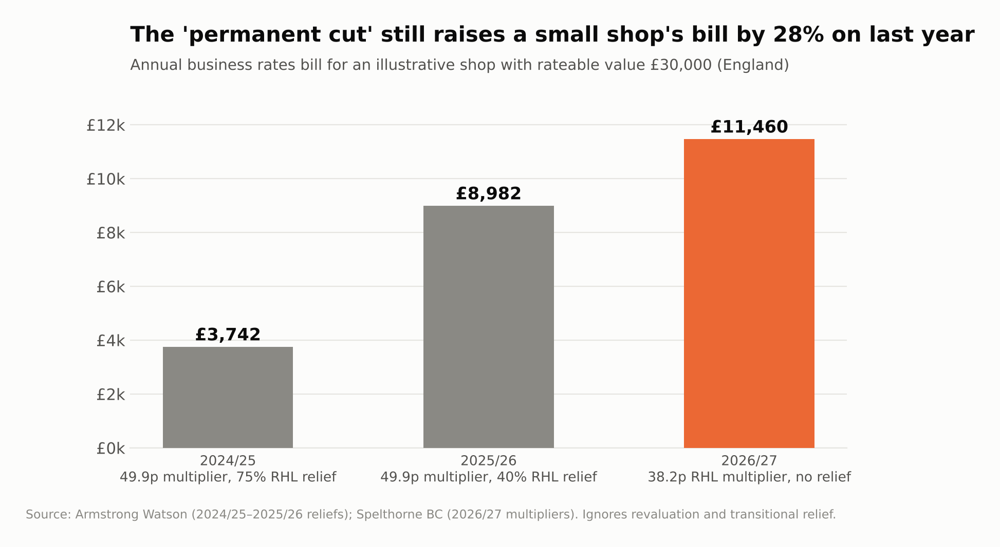
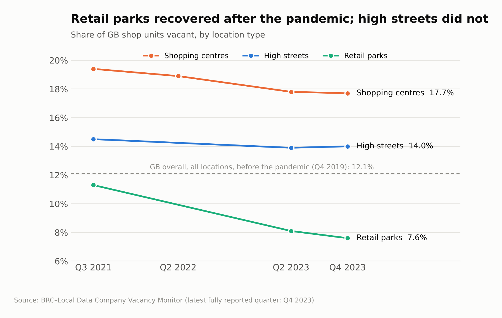
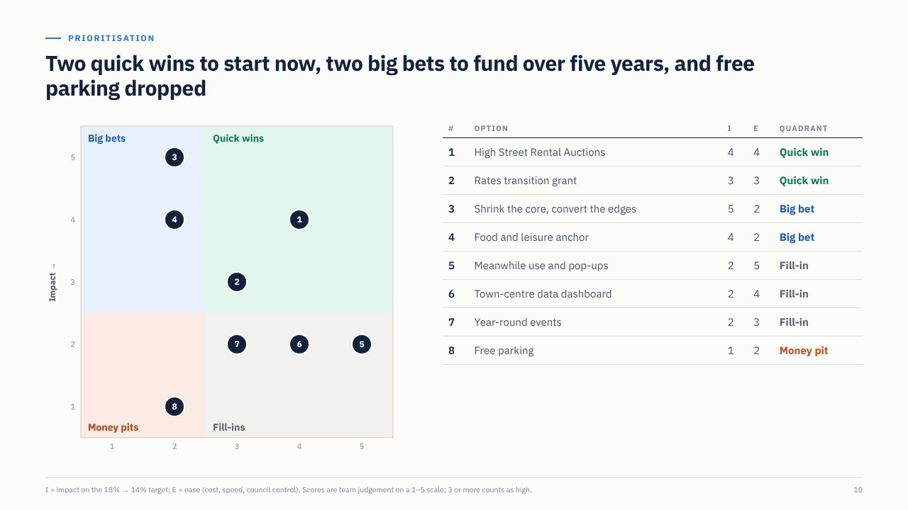

# UK High Street Turnaround

**A management-consulting case on one of the UK's most visible problems: empty high streets.** It runs from a vague brief to a prioritised five-year plan, built on public data, a reproducible Python analysis and a client-ready slide deck. It also includes **Issue Tree Studio**, a small web tool for the same structured problem-solving method.

> **The question:** How can Northbridge Council bring town-centre shop vacancy down from about 18% to 14% by 2030, while increasing footfall, using its existing powers and about £5m of capital?
>
> **The answer:** Shopping alone will not refill the centre. Northbridge should **shrink its retail core**, **fill empty units fast** with its new legal powers, and **give people reasons to come** that the internet can't replace: food, leisure, services and homes.

*Northbridge is an illustrative composite town, not a real client. Every number comes from a public source ([list](analysis/data/SOURCES.md)).*

[**📊 Slide deck (PDF)**](deck/High-Street-Turnaround-Deck.pdf) · [**🌳 Issue Tree Studio (live tool)**](https://itsaminzare.github.io/uk-high-street-turnaround/tool/) · [**📄 Case write-up**](case/01-problem-definition.md)



---

## Key findings

| | Finding | Evidence |
|---|---|---|
| **A. Demand** | The shift online is permanent | 27.5% of retail spending was online in 2025, against 19.2% in 2019; **72% of the pandemic jump has stuck** |
| **B. Supply** | There is too much space, in the wrong format | Retail park vacancy fell from 11.3% to 7.6%, while high streets stayed at 14%; struggling towns have **twice the retail space per person** of thriving ones |
| **C. Cost** | The 2026 business rates "cut" is a rise for small shops | A £30,000 rateable value shop's bill rises **28%** in 2026/27 (£8,982 → £11,460) as the 40% relief ends |
| **C. Cost** | Independents, not chains, are closing | **84%** of 2024's 13,479 closures were independents |
| **D. Activation** | Councils now have the power to act | High Street Rental Auctions (since Dec 2024) let councils let units empty more than a year without landlord consent |

Two of the eight starting hypotheses were **refuted**: that the rates reform helps small shops, and that chains leaving is the main problem. Both changed the recommendations.

<p>


</p>

## How the case was built

The work follows a standard consulting problem-solving process. Each step is a document in [`case/`](case/):

1. **[Define](case/01-problem-definition.md):** turn "what do we do about the high street?" into a SMART key question, with the decision-maker, success criteria, scope and constraints.
2. **[Structure](case/02-issue-tree.md):** a MECE issue tree (demand, supply, cost, activation), with a hypothesis and a planned analysis for each branch.
3. **[Analyse](case/03-findings.md):** test each hypothesis against public data in [`analysis/high_street_analysis.py`](analysis/high_street_analysis.py); every chart title states the finding.
4. **[Recommend](case/04-recommendations.md):** a pyramid-structured answer, an impact/ease prioritisation, a roadmap with KPIs, and risks with mitigations.



## Issue Tree Studio

A single-page web app for the same method, preloaded with this case. [**Open it here →**](https://itsaminzare.github.io/uk-high-street-turnaround/tool/)

- **Define:** write the key question and see a live SMART check
- **Structure:** build an issue tree, attach hypotheses, mark them supported, refuted or open, and record evidence; switch to a visual map
- **Prioritise:** score options for impact and ease and see them on a 2×2 matrix (quick wins, big bets, fill-ins, money pits)
- **Synthesise:** write the governing thought and key lines, and preview the storyline as a pyramid
- Saves in the browser, exports to Markdown or a JSON file, and works on phones

It's plain HTML, CSS and JavaScript with no build step and no dependencies: [`tool/index.html`](tool/index.html).

## Repository layout

```
case/                    The case write-up: define, structure, findings, recommendations
analysis/
  data/                  Public-data snapshots (CSV) and SOURCES.md
  high_street_analysis.py    Prints the key numbers and draws every chart
  fetch_ons.py           Refreshes the ONS online-share series from the official source
  charts/                Charts for the README (charts/plain/ = untitled versions for slides)
deck/
  High-Street-Turnaround-Deck.pdf   13-slide client deck
  source/                Deck HTML and build script
tool/index.html          Issue Tree Studio
```

## Run it yourself

```bash
cd analysis
pip install -r requirements.txt
python fetch_ons.py              # optional: refresh ONS data
python high_street_analysis.py   # prints key numbers, redraws charts
PLAIN=1 python high_street_analysis.py   # untitled charts for the deck
```

To open the tool locally, open `tool/index.html` in a browser.

## Skills this project demonstrates

- **Structured problem solving:** SMART problem definition, MECE issue trees, hypothesis-driven analysis
- **Quantitative analysis:** cleaning and combining public data (ONS, BRC–LDC, Centre for Retail Research) in Python with pandas and matplotlib
- **Communication:** action titles, the pyramid principle, a client-ready deck and an executive summary
- **Prioritisation and implementation:** an impact/ease matrix, a phased roadmap, KPIs, and a risk register
- **Digital tools:** designing and building a web app that makes the method reusable

## About

Made by **Mohammadamin Zare**, student at University College London (UCL). [LinkedIn](https://www.linkedin.com/in/mohammadaminzare)

Built while taking part in McKinsey.org's Forward Program. This is an independent project, not affiliated with or endorsed by McKinsey & Company or McKinsey.org, and it contains no course materials.

**Data caveats.** Some figures come from secondary reports of the original data. Check them against the original publisher before citing them formally. Vacancy data is the latest quarterly series publicly reported in full (to Q4 2023).

© 2026 Mohammadamin Zare. All rights reserved. See [LICENSE](LICENSE).
