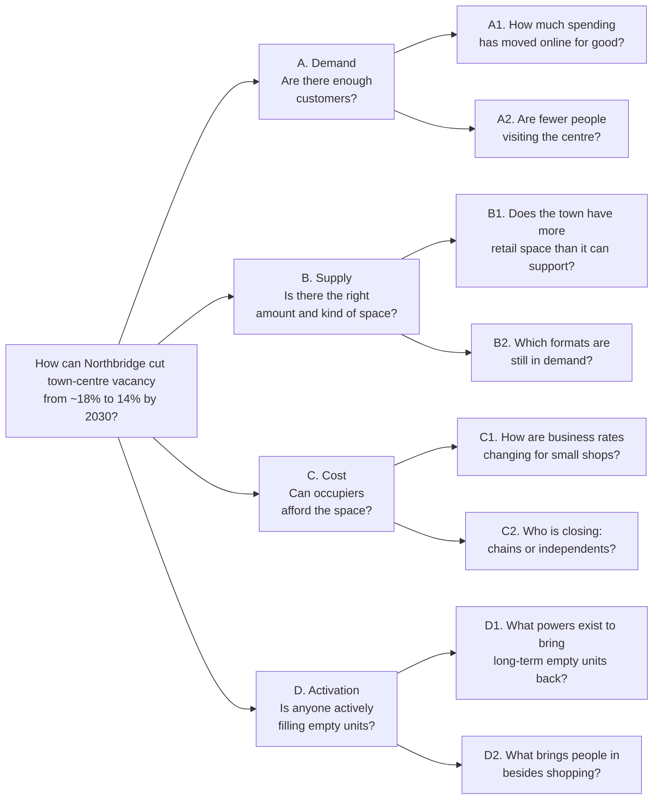

# 2. Issue tree and hypotheses

We broke the key question into parts that are **mutually exclusive and collectively exhaustive (MECE)**. Every reason a unit stays empty falls into exactly one branch: too few customers, the wrong space, too high a cost to occupy, or nobody actively filling it.

## Hypotheses, the test for each, and the verdict

We started with a hypothesis for each branch, so the analysis tests ideas instead of just collecting data.

| # | Hypothesis | Analysis to test it | Verdict |
|---|---|---|---|
| A1 | The shift online is structural, so shopping alone can't refill the centre | Online share of retail sales, 2007–2025 (ONS J4MC) | **Supported.** 27.5% online in 2025, against 19.2% in 2019; 72% of the pandemic jump has stuck |
| A2 | Footfall is still falling, so demand won't recover by itself | BRC–Sensormatic footfall, 2025 | **Supported, mildly.** Total UK footfall −0.8% in 2025; −2.9% in December |
| B1 | Struggling towns have more retail space than local spending can support | Centre for Cities retail space per person | **Supported.** Towns like Newport, Wigan and Middlesbrough have more than twice the retail space per person of Brighton or Liverpool |
| B2 | Convenient, easy-access formats are winning; enclosed centres and high streets lag | Vacancy by location type, 2021–2023 | **Supported.** Retail parks 11.3% → 7.6%; high streets 14.5% → 14.0%; shopping centres 19.4% → 17.7% |
| C1 | The 2026 business rates reform lowers costs for small shops | Bill for an illustrative £30,000 rateable value shop, 2024/25–2026/27 | **Refuted.** The bill rises 28% on 2025/26 (£8,982 → £11,460), because the new lower multiplier replaces a 40% relief |
| C2 | Chains leaving is the main cause of closures | Centre for Retail Research closures, 2018–2024 | **Refuted.** Independents were 84% of 2024 closures (11,341 of 13,479) |
| D1 | The council has a new tool to force long-term empty units back into use | High Street Rental Auctions (in force since 2 Dec 2024) | **Supported.** Councils can auction 1–5 year leases on units empty more than a year, without landlord consent |
| D2 | Strong centres draw people with food and leisure, not just shops | Centre for Cities spending mix | **Supported.** Food is about £1 in every £4 spent in York and Edinburgh, against about £1 in £10 in Bradford, Stoke and Wigan |

Two of eight hypotheses were refuted, and both changed the recommendations. We stopped treating rates as a problem already fixed by government, and we focused support on independents rather than on chasing national chains.
