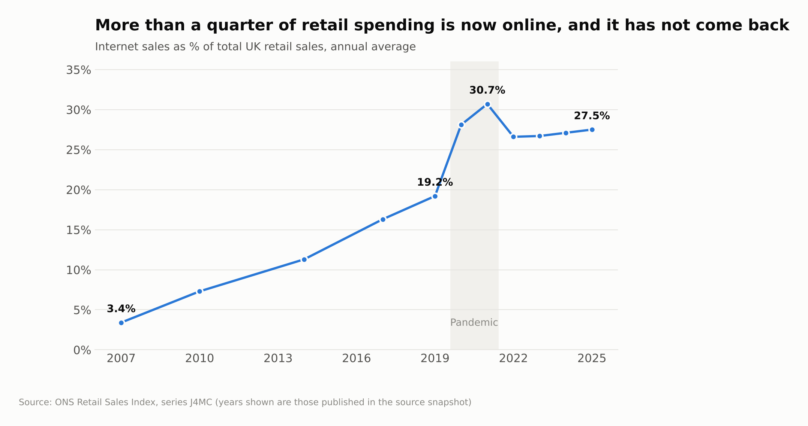
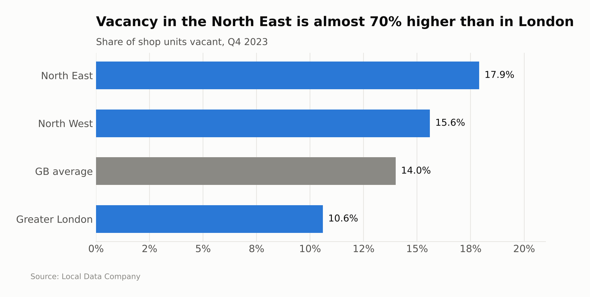
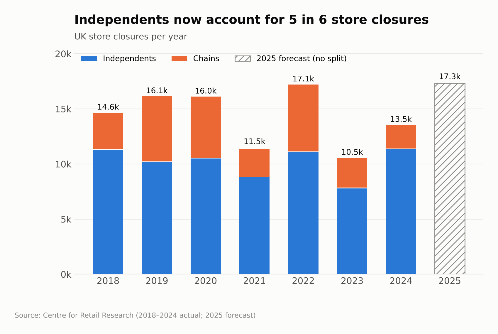

# 3. Findings

Each finding answers one branch of the [issue tree](02-issue-tree.md). Chart titles state the finding; the numbers come from [`analysis/high_street_analysis.py`](../analysis/high_street_analysis.py), and every source is listed in [`analysis/data/SOURCES.md`](../analysis/data/SOURCES.md).

## A. Demand: shopping alone won't refill the centre

- In 2025, **27.5%** of UK retail spending was online, up from 19.2% in 2019 and 3.4% in 2007.
- The share peaked at 30.7% in 2021 and has settled since, but **72% of the pandemic jump has stuck**. This is a permanent shift, not a temporary shock.
- Footfall is still drifting down: **−0.8%** across 2025, and **−2.9%** in December 2025 (BRC–Sensormatic).

**So what:** Northbridge can't win back the spending that moved online. The centre needs reasons to visit that the internet can't replace: food, services, events, and people living there.

## B. Supply: too much space, in the wrong format

- Vacancy is not one problem. Since the 2021 peak, **retail parks** recovered from 11.3% to 7.6%, below their pre-pandemic level. **High streets** barely moved (14.5% → 14.0%), and **shopping centres** remain worst at 17.7%.
- Struggling towns have **more than twice the retail space per person** of thriving ones (Centre for Cities, 2025). Newport, Wigan and Middlesbrough each have more than one in seven shops empty.

- Vacancy in the **North East (17.9%) is almost 70% higher than in Greater London (10.6%)**. Northbridge's problem is regional as well as local.

**So what:** even a successful plan won't fill every unit as a shop. The council should *shrink* the retail footprint to a compact core and repurpose the rest.

## C. Cost: the rates "cut" is a rise for small shops, and independents are the ones closing

- From April 2026, retail, hospitality and leisure properties in England get permanently lower multipliers (38.2p under £51,000 rateable value), but the **40% relief disappears**.
- For a typical small shop with a rateable value of £30,000, the bill **rises 28%**, from £8,982 to £11,460, and is **three times** the 2024/25 bill of £3,742. *(Illustrative: ignores the 2026 revaluation and transitional relief.)*

- **Independents made up 84% of closures in 2024** (11,341 of 13,479). Chain closures peaked in 2019, 2020 and 2022, but have fallen since.
- The Centre for Retail Research forecast about **17,350 closures in 2025**, up 29% on 2024, the highest in the series.

**So what:** the council's most vulnerable occupiers are the independents that make up most of a northern town centre. They face a rates cliff in 2026/27, so keeping the ones already there is as important as attracting new ones.

## D. Activation: the council now has the tools to act

- **High Street Rental Auctions** (in force since 2 December 2024) let councils in England auction 1–5 year leases on high street units that have been empty for more than a year, **without the landlord's consent**.
- Thriving centres have moved from retail to **food and leisure**. Food is about £1 in every £4 spent in York and Edinburgh, but only about £1 in £10 in Bradford, Stoke and Wigan (Centre for Cities).

**So what:** the council doesn't have to wait for landlords. It can force long-term empty units back into use and steer what goes into them.
